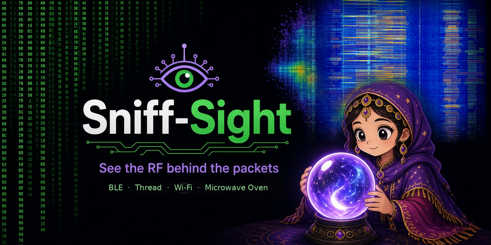
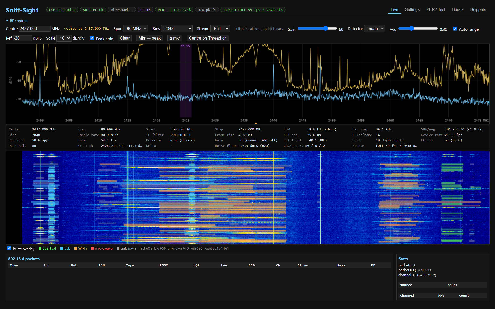
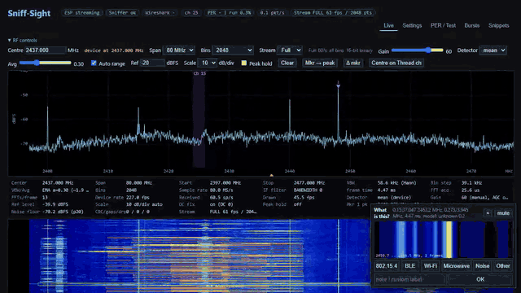
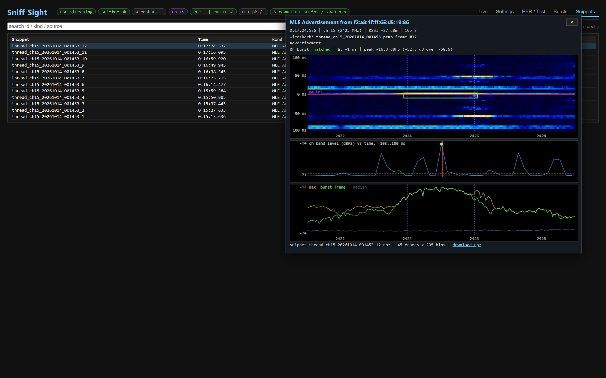
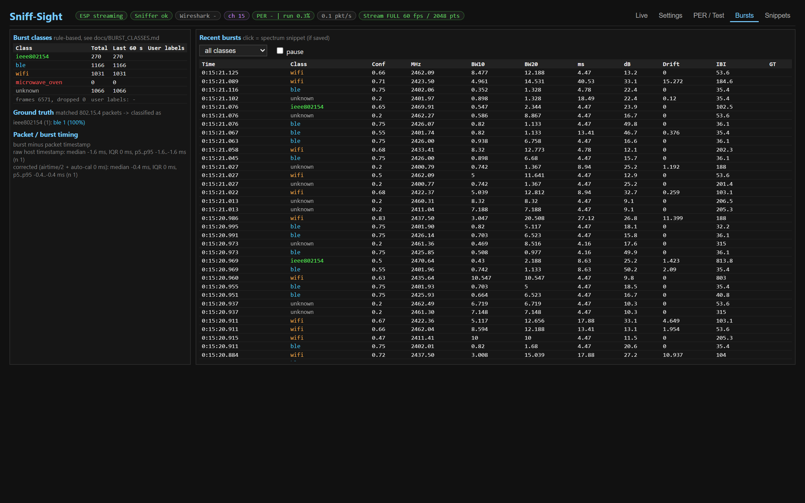
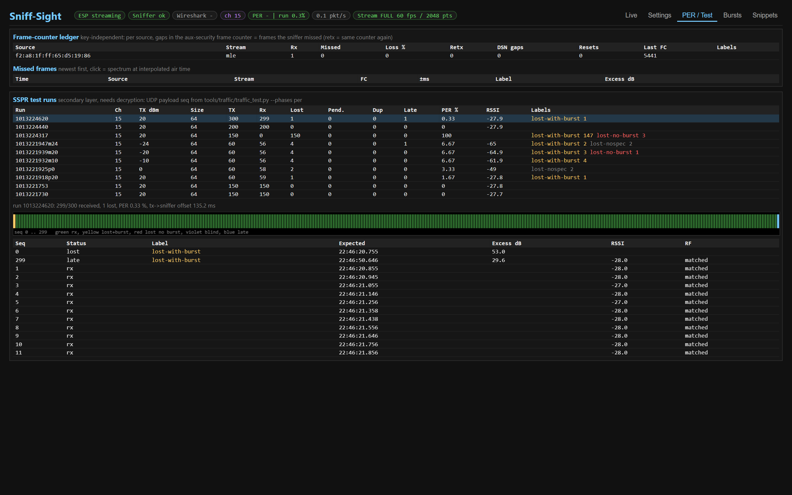
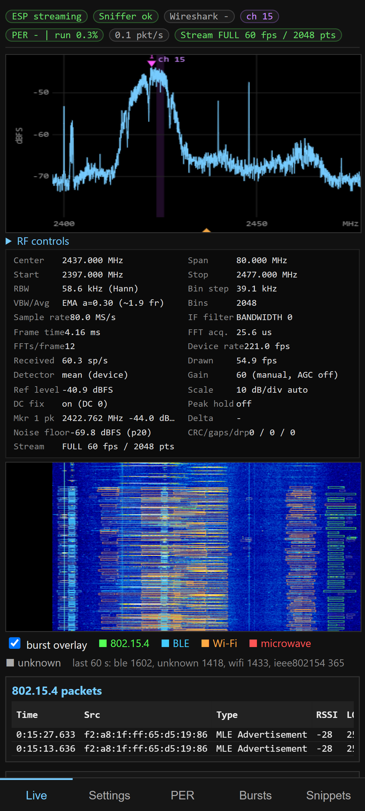
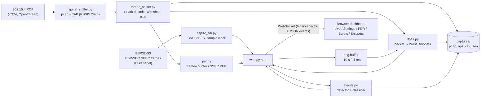

# Sniff-Sight

**An open, ~$30-hardware dual analyzer for 2.4 GHz: a live spectrum/waterfall and an IEEE 802.15.4 / Thread packet sniffer on one correlated timeline.**

Every captured packet is paired with the RF burst that carried it and saved as a short spectrum snippet. Frame-counter-based PER shows which frames the sniffer missed and why. Every RF burst (802.15.4, BLE, Wi-Fi, microwave oven, unknown) is classified, and you can label bursts in the browser to grow a training set.

**Try it without hardware:** [live demo page](https://z2labs.github.io/Sniff-Sight/demo/) (canned capture replayed in the real dashboard) or `scripts/start.bat --demo` / `./scripts/start.sh --demo` locally.





([higher quality MP4](docs/img/demo.mp4))

## Features

- **Spectrum + waterfall** from an ESP32-S3 running the ESP-SDR firmware: 16/40/80 MHz span, 256–2048 bins, ~220 spectra/s from the device, gapless (CRC-checked frames, sequence-gap and drop counters).
- **Spectrum-analyzer style readout**: center/span/start/stop, RBW (Hann, 1.5·fs/N), bin step, sample rate, frame time, FFT acquisition time, FFTs per frame, device/received/drawn rates, detector, gain, ref level and scale, DC fix, markers (click, peak-tracking, delta), noise-floor estimate, CRC/gaps/drops.
- **802.15.4 / Thread packet capture** from an OpenThread RCP (Silicon Labs xG24 tested): pcap with TAP headers (RSSI, LQI, channel), `tshark` decoding with your Wireshark keys, optional live Wireshark, channel hopping.
- **Packet ↔ RF correlation**: one host clock for both streams. Each packet is paired with the nearest burst on its channel (`matched` / `weak` / `none` / `nospec`), and a ±100 ms × ±4 MHz spectrum snippet (`.npz`) is saved for every packet.
- **PER without keys**: per-source gaps in the 802.15.4 aux-security frame counter give the frames the sniffer missed. Retransmissions and DSN skips are tracked too. With decryption, an optional SSPR test-traffic ledger gives sequence-exact PER per run and TX power.
- **Burst classification** (rule-based: bandwidth, duration, drift, inter-burst interval), with ground truth from matched packets and an **active-learning "What is this?" card** that asks you to label uncertain bursts (`labels.csv`).
- **Remote-friendly web UI**: binary WebSocket stream (16-bit full, 8-bit light), a per-client light mode for slow links (max-hold, decimated, points matched to the screen), a mobile layout, optional login (cookie or HTTP Basic).
- **Test-traffic tooling** (`tools/traffic`) for ESP32-C6 OpenThread CLI nodes: bursts, sizes, density, unicast/SED, TX-power steps, scans, PER runs.

## Screenshots

| | |
|---|---|
|  Packet detail: waterfall around the packet, channel level vs time, spectra |  Burst classes, ground truth, timing |
|  Frame-counter PER ledger and SSPR runs |  Mobile layout |

## Hardware

| Part | Role | Notes |
|---|---|---|
| ESP32-S3 dev board (native USB) | Spectrum source | Flash the **ESP-SDR** firmware from [z2labs](https://github.com/z2labs) (see also [ESPARGOS/esp-sdr](https://github.com/ESPARGOS/esp-sdr)). The S3 has an on-chip 2.4 GHz receiver; SPEC mode streams Hann-windowed FFT power frames over USB. |
| Silicon Labs xG24 (e.g. BRD4187C radio board + WSTK/WPK mainboard) | 802.15.4 sniffer | OpenThread **RCP** firmware, driven with [pyspinel](https://github.com/openthread/pyspinel) in promiscuous mode. Other OpenThread RCPs (nRF52840 dongle, etc.) should work but are untested. |
| 1–2 × ESP32-C6 | Thread test nodes (optional) | ESP-IDF `ot_cli` example; used by `tools/traffic/traffic_test.py`. |

The ESP32-S3 and C6 boards cost a few dollars each, so the core spectrum-plus-sniffer setup is about $30 if you use a cheap RCP dongle.

## Architecture



## Quick start

Windows (PowerShell):

```powershell
git clone https://github.com/z2labs/Sniff-Sight.git; cd Sniff-Sight
powershell -ExecutionPolicy Bypass -File scripts\install.ps1 -WithSpinel   # winget Wireshark + Python, .venv, pip install -e .
scripts\start.bat --demo                                                  # canned data, no hardware
scripts\start.bat --esp-port COM7 --thread-port COM16 --channel 15         # with hardware
```

Linux / macOS:

```bash
git clone https://github.com/z2labs/Sniff-Sight.git && cd Sniff-Sight
./scripts/install.sh --with-spinel        # apt or brew
./scripts/start.sh --demo
./scripts/start.sh --esp-port /dev/ttyACM0 --thread-port /dev/ttyACM1 --channel 15
```

Details, manual install and the demo: [docs/INSTALL.md](docs/INSTALL.md).

Manual install:

```bash
python -m venv .venv && . .venv/bin/activate      # Windows: .venv\Scripts\activate
pip install -e .
# separate venv for the RCP sniffer (pyspinel); default location ../spinel_venv
python -m venv ../spinel_venv && ../spinel_venv/bin/pip install pyspinel pyserial
python -m sniff_sight --esp-port COM7 --thread-port COM16 --channel 15     # Linux: /dev/ttyACM0 ...
```

Open <http://127.0.0.1:8000>. Wireshark/tshark are needed for packet decoding. The code currently assumes the Windows install path `C:\Program Files\Wireshark` and uses a Windows named pipe for live Wireshark.

Flashing:
- ESP32-S3: the dashboard bundles an ESP-SDR build and can flash it from *Settings > Firmware* (Web Serial, Chrome/Edge), or use `esptool.py` with `sniff_sight/firmware/flash_args`.
- xG24: build or flash the OpenThread RCP (`ot-rcp`) from Simplicity Studio / GSDK, at 460800 baud.
- ESP32-C6 nodes: ESP-IDF `examples/openthread/ot_cli`. Setup is in [tools/traffic/SETUP_NODE2.md](tools/traffic/SETUP_NODE2.md).

Useful options (`python -m sniff_sight -h` for all):

| Option | Meaning |
|---|---|
| `--esp-port`, `--thread-port`, `--thread-baud` | serial ports |
| `--freq`, `--span {16,40,80}e6`, `--bins {256..2048}`, `--gain` | initial SDR settings (4096 bins is experimental; current firmware rejects it and the app falls back to 2048) |
| `--channel N` / `--hop [LIST] --dwell S` | sniffer channel or hopping |
| `--no-esp`, `--no-thread`, `--no-wireshark` | disable parts |
| `--demo` | replay the bundled sample capture (no hardware, no serial ports) |
| `--host`, `--http-port`, `--also-localhost` | web server binding |
| `--auth USER:PASS` / `--auth-file FILE` | require login |
| `--captures DIR` | output folder (default `../captures`, env `SNIFF_CAPTURES`) |

Environment: `SNIFF_WORKDIR`, `SNIFF_CAPTURES`, `SNIFF_SPINEL_VENV`, `SNIFF_PUSH_HZ` (full stream, default 60), `SNIFF_LITE_HZ` (light stream, default 25).

## Remote access (Tailscale)

Bind to your tailnet IP plus localhost and protect the UI:

```bash
echo "viewer:$(openssl rand -base64 15)" > ../sniff_auth.txt      # keep it outside the repo; *_auth.txt is gitignored
python -m sniff_sight --host <tailscale-ip> --also-localhost --auth-file ../sniff_auth.txt
tailscale serve  --bg 8000        # tailnet only
tailscale funnel --bg 8000        # public internet: ALWAYS use --auth/--auth-file
tailscale funnel reset            # turn it off again
```

Over https or from another host the page uses the **Light** stream automatically. You can switch between Auto, Full and Light under *Stream*. Light is about 40–110 KB/s, compared with about 330 KB/s for Full at 60 spectra/s.

## Data outputs (`captures/`)

| Path | Content |
|---|---|
| `thread_ch15_*.pcap` / `thread_hop_*.pcap` | 802.15.4 frames with TAP TLVs (RSSI, LQI, channel) |
| `snippets/<pcap>_<frame>.npz` | per-packet spectrum snippet: `db`, `freqs_mhz`, `times_s`, `meta`, `pair` |
| `per/fc_missed_*.csv`, `fc_summary.json`, `per_<run>_*.csv/json` | PER ledgers and summaries |
| `bursts/bursts_*.csv`, `bursts/labels.csv` | classified bursts, your labels |
| `traffic/traffic_*.csv` | test-traffic command log |

## Limits

- **Timing ±5 ms.** Packet times are host timestamps taken after the RCP/UART path. A spectrum frame is about 4.5 ms long at 80 MHz / 2048 bins, so Δt is good for attributing bursts to packets, not for sub-millisecond timing.
- **2048 bins max** with current ESP-SDR firmware (4096 is not in `SPECINFO`).
- The mean detector dilutes short packets by the packet/frame length ratio. Use the max detector for weak short bursts.
- The RCP drops frames with bad FCS, so CRC errors show up as RF bursts without a matching packet, not as bad frames.
- Burst classification is rule-based and approximate. Busy Wi-Fi channels can mislead pairing.
- Wireshark integration (named pipe, install path) is Windows-specific today.

More detail: [packet/RF pairing](#packet--rf-burst-pairing-details), [docs/BURST_CLASSES.md](docs/BURST_CLASSES.md), [tools/traffic/TEST_PLAN.md](tools/traffic/TEST_PLAN.md).

## Custom testbenches & RF benchmarking

The free edition supports **2 test (TX) nodes**. Larger and more complex testbenches (up to 5 and more TX nodes, scheduled
Teacher-network lessons with automatic burst labelling, classifier evaluation and retraining) are available as
**Pro features and custom consulting**.

We welcome requests to build more complex testbenches, drawing on 20 years of experience in RF benchmarking:
multi-vendor radio performance comparisons, receiver sensitivity and immunity, transmitter emission masks, static and dynamic
current consumption, and self-contained conducted link-budget test setups.

- Article: [Radio performance benchmarking](https://blog.z2labs.io/article/radio-performance-benchmarking) (a compact conducted test environment)
- Video: [Linquisitor demo (YouTube)](https://www.youtube.com/watch?v=lf_YzTGfvR8)
- Contact: hello [at] z2labs [dot] io

## Roadmap

- Custom RCP build that forwards frames with bad FCS (true CRC-error capture)
- Linux/macOS Wireshark live pipe, packaged releases
- Learned burst classifier trained on `labels.csv`
- Optional raw IQ capture around packets (ESP-SDR RING/IQ modes)
- Multiple SDRs and channels, nRF52840 sniffer support

## License

GPL-3.0-only, see [LICENSE](LICENSE). Bundled firmware and other third-party parts: see [NOTICE](NOTICE).

## Credits

- [z2labs](https://github.com/z2labs) and [ESPARGOS / esp-sdr](https://github.com/ESPARGOS/esp-sdr) (Florian Euchner and contributors) for the ESP32 SDR firmware, the SPEC protocol and z2-web-sdr, which the spectrum handling mirrors.
- The bundled ESP32-S3 firmware (`sniff_sight/firmware/`) is built from [zodoczi/esp-sdr](https://github.com/zodoczi/esp-sdr) revision `4128c24`, a fork of [ESPARGOS/esp-sdr](https://github.com/ESPARGOS/esp-sdr) (GPL-3.0); the Settings flasher is a port of the z2-web-sdr flasher.
- [OpenThread](https://openthread.io), [pyspinel](https://github.com/openthread/pyspinel), [Wireshark](https://www.wireshark.org).
- Silicon Labs and Espressif SDKs.

---

## Packet ↔ RF burst pairing (details)


Every decoded 802.15.4 packet is paired with the spectrum around it:

- **Common clock.** Spectrum frames are stamped in the same process, on the same host clock (`time.time()`), that
  the sniffer uses for its pcap timestamps. Each frame's firmware sample index (sample index / sample rate) is
  anchored to host time using the minimum `arrival - device time` over a sliding 4 s window. This removes most of
  the USB/serial latency jitter and still follows slow clock drift.
- **Ring buffer.** The last ~10 s of spectrum frames are kept at full bins (int16, 0.1 dB steps; ~2200 frames x 2048 bins).
- **Snippet.** For each packet, the frames within +-100 ms of the packet time and the bins within +-4 MHz of the
  channel frequency are cut out. They are saved to `..\captures\snippets\<capture-base>_<pcap frame no.>.npz`,
  for example `thread_ch15_20261013_181241_5.npz` is frame #5 in `thread_ch15_20261013_181241.pcap`. Arrays saved:
  `db`, `freqs_mhz`, `t0_s`, `t1_s`, `times_s` (relative to the packet), `t_packet`, and `meta` / `pair` as JSON.
- **Pairing.** The script computes the channel's mean power per frame within +-1 MHz and takes the median over the
  snippet as the floor. Frames more than max(3 dB, 3 sigma) above the floor are grouped into bursts, and the burst
  nearest the packet time is chosen. Results:
  - `matched`: at least 6 dB over the floor and within 50 ms;
  - `weak`: above the threshold but quieter or further away;
  - `none`: nothing above the threshold;
  - `nospec`: the channel is outside the current spectrum view.

  The packet list shows Δt (burst minus packet, ms), the burst's peak level (dBFS) and the result. The status line
  shows the counts and the median Δt.
- **Panel.** Click or tap a packet row to open the snippet: a waterfall (time downwards, red line = packet time,
  box = detected burst), the channel level over time with the floor and threshold, and the spectrum (max, burst frame,
  median). It also shows the pcap file and frame number, so the packet can be found in Wireshark (`frame.number == N`).
- **API.** `GET /api/snippets` lists recent packets with their pairing results, plus the older snippet files.
  `GET /api/snippets/<id>` returns a snippet as JSON; `GET /api/snippets/<id>.npz` returns the file.

**Limits.**
- The packet time is a host timestamp. It is taken when the frame comes out of pyspinel, after the over-the-air
  time, the RCP and 460800-baud UART delay, and the queue. That puts it ~1-5 ms after the end of the packet, with
  jitter.
- The spectrum's time resolution is one frame: about 4.5 ms at 80 MHz / 2048 bins (other spans and bin counts give
  longer frames, up to ~12 ms). An 802.15.4 frame lasts 0.1-4 ms (4.2 ms for 127 bytes), so a burst lights up 1-2
  frames, and the mean detector dilutes it by the ratio of packet length to frame length.
- Δt is therefore only good to roughly +-5 ms. It is fine for attributing a burst to a packet, but not for
  sub-millisecond timing.
- In a busy band (Wi-Fi overlapping the channel), the nearest burst may not be the packet. Check `bursts_in_snippet`
  in the pair result and the panel.

## Contact

hello [at] z2labs [dot] io

